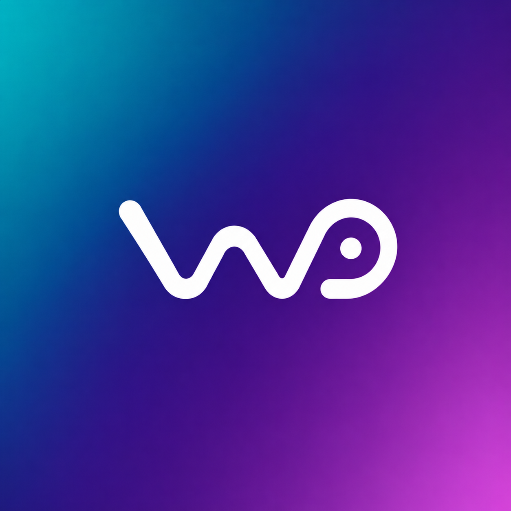
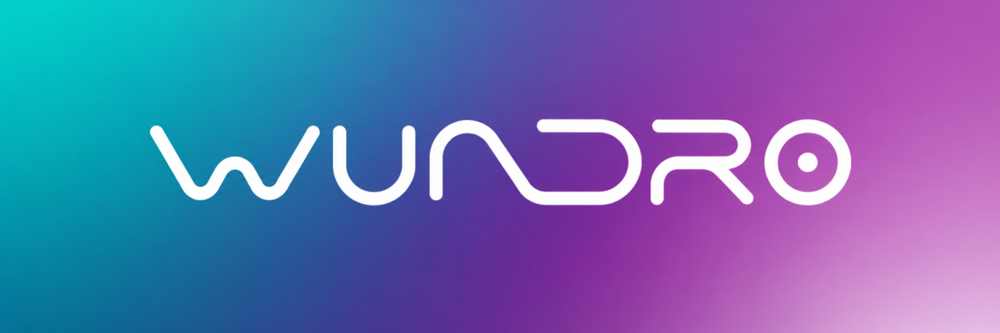

> [!IMPORTANT]
> ## 🚀 Start Here — Pitch & Live Demo
>
> **[📄 Read the Wundro One-Page Solution Pitch](./Wundro_One_Page_Solution_Pitch_Updated.pdf)**
> &nbsp;&nbsp;|&nbsp;&nbsp;
> **[▶️ Watch the Wundro Demo on YouTube](https://youtu.be/lp1_WFzyXIU)**
>
> The pitch gives the complete solution at a glance; the video shows Wundro working end to end.

<p align="center">
  
</p>

<h1 align="center">Wundro</h1>

<p align="center">
  <strong>Speak the world into place.</strong><br/>
  A production-quality multilingual voice AR experience for the
  <a href="https://www.gnani.ai/">Gnani.ai</a> Internship Challenge.
</p>

<p align="center">
  
</p>

<p align="center">
  <a href="https://www.gnani.ai/">
    
  </a>
</p>

<p align="center">
  <a href="https://www.gnani.ai/">
    
  </a>
  &nbsp;·&nbsp;
  Built for the Gnani.ai Internship Challenge
</p>

<p align="center">
  
  
  
  
  
</p>

---

## Built for the Gnani.ai Internship Challenge

Wundro was designed and built as a submission for the **Gnani.ai internship challenge** —
a mobile-first AR assistant that listens in natural speech (English, Hindi, Marathi, and
code-mix), plans actions with Cohere, and answers back with Gnani Timbre.

| Wundro | Gnani.ai |
| :---: | :---: |
|  | <br/> |
| Conversational WebXR world | Prisma STT · Timbre TTS |

**What reviewers should feel in under a minute:** open the camera → tap **Start AR** →
hold the circular mic → speak naturally → watch objects appear → hear a witty reply.

---

## Why Wundro stands out

- **Camera-first AR UX** inspired by the clarity of polished consumer AR apps — brand on
  the home screen, one circular Start AR control, then mic + quiet close once XR begins.
- **Hold-to-talk done right** — short taps never spam Prisma; silence is handled gracefully;
  listening / processing / speaking states stay minimal and readable against live camera feed.
- **True multilingual voice** — Prisma `hi-IN,en-IN,mr-IN` with Timbre `auto` language routing.
  No language menu. Code-mix is welcome.
- **Dynamic 3D world** — Poly Haven discovery + verified local GLB fallbacks, translucent
  previews, aim placement, and Scene Manager commands driven by spoken intent.
- **Honest personality** — short, witty, context-aware TTS replies grounded in *actual*
  execution results (never fabricated “success”).

---

## Architecture at a glance

```text
┌─────────────── Phone (Chrome / WebXR) ───────────────┐
│  Landing → Start AR → Hold-to-talk mic + Exit        │
│  Three.js scene · Aim placement · Asset preview      │
└───────────────────────┬──────────────────────────────┘
                        │  ADB reverse / LAN → Vite :5173
                        ▼
┌─────────────── Vite (frontend) ──────────────────────┐
│  Static app + /api proxy (120s timeouts)             │
└───────────────────────┬──────────────────────────────┘
                        │  http://127.0.0.1:8000
                        ▼
┌─────────────── FastAPI (backend) ────────────────────┐
│  /api/voice/plan      → Prisma STT → Cohere plan     │
│  /api/voice/speak     → Timbre intermediate TTS      │
│  /api/assets/resolve  → Poly Haven / local fallback  │
│  /api/voice/complete  → Cohere reply → Timbre TTS    │
│  /api/voice/diagnostics/{request_id}                 │
└──────────────────────────────────────────────────────┘
```

| Layer | Stack |
| --- | --- |
| Frontend | Vite, Three.js WebXR, custom circular PTT HUD |
| Backend | FastAPI, Pydantic, httpx |
| Speech | **Gnani Prisma** (STT) · **Gnani Timbre** (TTS) |
| Reasoning | **Cohere** structured JSON action plans + spoken replies |
| Assets | Poly Haven (CC0) + local sofa / table / chair / plant GLBs |

---

## Repository layout

```text
Gnani Project/
├── README.md                 ← you are here
├── docs/assets/              ← Gnani brand marks for this README
├── backend/
│   ├── app/                  ← FastAPI app, voice, interpreter, assets
│   ├── tests/
│   ├── .env.example
│   └── requirements.txt
└── frontend/
    ├── public/               ← Wundro logos + fallback GLBs
    ├── src/                  ← WebXR client, voice pipeline, HUD
    └── package.json
```

---

## Prerequisites

| Tool | Notes |
| --- | --- |
| **Python 3.11+** | Backend virtualenv |
| **Node.js 20+** | Frontend Vite app |
| **Android phone** | WebXR AR (Chrome recommended) |
| **USB cable** | For ADB reverse port-forward |
| **Cohere API key** | Server-side only |
| **Gnani API key** | Prisma + Timbre access for your account |

---

## 1. Clone & configure

```powershell
git clone https://github.com/RealPratham21/Gnani-Internship-Challenge.git
cd "Gnani-Internship-Challenge"

cd backend
python -m venv .venv
.\.venv\Scripts\Activate.ps1
python -m pip install -r requirements.txt
Copy-Item .env.example .env
```

Edit `backend/.env` and set at least:

```env
COHERE_API_KEY=your-cohere-key
GNANI_API_KEY=your-gnani-key
```

Defaults already match the documented Gnani REST surface used by this project:

| Variable | Default |
| --- | --- |
| `GNANI_PRISMA_URL` | `https://api.vachana.ai/stt/v3` |
| `GNANI_PRISMA_MODEL` | `prisma-v3.0` |
| `GNANI_PRISMA_LANGUAGE` | `hi-IN,en-IN,mr-IN` |
| `GNANI_PRISMA_FORMAT` | `codemix` |
| `GNANI_TIMBRE_URL` | `https://api.vachana.ai/api/v1/tts/inference` |
| `GNANI_TIMBRE_MODEL` | `timbre-v3.0` |
| `GNANI_TIMBRE_LANGUAGE` | `auto` |
| `GNANI_TIMBRE_VOICE` | `Avinash` |

> Never commit `.env`. Only `.env.example` is tracked.

---

## 2. Run the app (two terminals)

**Terminal A — backend**

```powershell
cd backend
.\.venv\Scripts\Activate.ps1
uvicorn app.main:app --reload --host 0.0.0.0 --port 8000
```

**Terminal B — frontend**

```powershell
cd frontend
npm install
npm run dev
```

Vite serves the client on **`http://localhost:5173`** and proxies `/api` → FastAPI `:8000`.

Desktop browser can open the UI for sanity checks, but **AR + mic validation is on the phone**.

---

## 3. Phone setup — complete USB debugging & ADB guide

Wundro talks to your laptop. The phone does **not** need the public internet for `/api`
(though Cohere/Gnani calls leave from the laptop). Use **ADB reverse** so the phone’s
`localhost:5173` reaches your Vite server — this also keeps WebXR’s secure-context story
simple (`https` or `localhost`).

### Step A — Enable Developer options on Android

1. Open **Settings → About phone**.
2. Tap **Build number** seven times until you see “You are now a developer”.
3. Back out to **Settings → System → Developer options** (wording varies by OEM).

### Step B — Enable USB debugging

In **Developer options**, enable:

1. **USB debugging**
2. (Optional but useful) **USB debugging (Security settings)** / “Disable permission monitoring” only if your OEM requires it for reverse
3. Keep the phone unlocked while pairing the first time

### Step C — Install ADB on your laptop

**Windows (recommended — platform-tools zip)**

1. Download Android **platform-tools** from Google:
   [https://developer.android.com/tools/releases/platform-tools](https://developer.android.com/tools/releases/platform-tools)
2. Extract somewhere stable, e.g. `C:\platform-tools`
3. Add that folder to your user **PATH**, *or* call `adb.exe` with the full path
4. Verify:

```powershell
adb version
```

**Windows (package managers)**

```powershell
# winget
winget install --id Google.PlatformTools -e

# or Chocolatey
choco install adb
```

**macOS**

```bash
brew install android-platform-tools
adb version
```

**Linux (Debian/Ubuntu)**

```bash
sudo apt update
sudo apt install adb
adb version
```

### Step D — Connect the phone & authorize the RSA prompt

1. Plug the phone into the laptop with a **data-capable** USB cable (charge-only cables fail silently).
2. On the phone, set USB mode to **File transfer / MTP** if prompted.
3. Run:

```powershell
adb devices
```

4. The phone should show a dialog: **“Allow USB debugging?”**
   Check **Always allow from this computer** → tap **Allow**.
5. Re-run `adb devices`. You want:

```text
List of devices attached
XXXXXXXX    device
```

If you see `unauthorized`, revoke USB debugging authorizations in Developer options, unplug/replug, and accept the prompt again.

### Step E — Reverse port-forward (the important bit)

With Vite running on the laptop:

```powershell
adb reverse tcp:5173 tcp:5173
adb reverse --list
```

You should see something like:

```text
UsbFfs tcp:5173 tcp:5173
```

This maps **phone `localhost:5173` → laptop `localhost:5173`**.

> Tip: USB blips, cable unplugs, and deep sleep can drop reverse. Re-run
> `adb reverse tcp:5173 tcp:5173` anytime the phone suddenly can’t reach `/api`.

### Step F — Open Wundro on the phone

1. On the phone, open **Chrome**.
2. Visit: **`http://localhost:5173`**
3. You should see the Wundro landing screen (logo + wordmark + **Start AR**).
4. Allow **microphone** when prompted (first hold-to-talk).
5. Tap **Start AR**, accept the camera / AR permission sheet, then hold the mic and speak.

### Step G — Optional health check on the phone

While reverse is active, open:

```text
http://localhost:5173/api/health
```

You want JSON roughly like `{ "status": "ready", ... }`. If this fails, the voice pipeline
will also fail with a network error — fix ADB reverse / Vite / backend first.

---

## 4. Using the experience

| Moment | What you do | What Wundro does |
| --- | --- | --- |
| Landing | Look at brand, tap circular **Start AR** | Enters WebXR, shows mic + × close |
| Talk | **Hold** the mic, speak, release | Prisma → Cohere → world update → Timbre |
| Place | Aim with the crosshair / say where | Preview → place pending asset |
| Exit | Tap **×** (top-right) | Ends AR, returns to landing |

### Try these prompts

- English: *“Add a wooden table here.”*
- Hindi: *“Sofa chhota karo.”*
- Marathi: *“खुर्ची इथे ठेव.”*
- Code-mix: *“Mujhe ek plant chahiye.”* then *“Yahin rakh.”*

### Voice UX guarantees

- Accidental tap → **“Hold to talk.”** (no Prisma call)
- Silence → **“Didn’t catch that. Try again.”**
- States: Ready · Listening · Processing · Downloading · Speaking · Error
- Overlay controls block accidental WebXR object placement

---

## 5. API surface (backend)

| Method | Path | Purpose |
| --- | --- | --- |
| `GET` | `/api/health` | Ready check + provider configuration flags |
| `POST` | `/api/voice/plan` | WAV + scene/world → transcript + actions |
| `POST` | `/api/voice/speak` | Intermediate Timbre line |
| `POST` | `/api/voice/complete` | Final witty reply + Timbre audio |
| `POST` | `/api/voice/events` | Client diagnostics (non-blocking) |
| `GET` | `/api/voice/diagnostics/{request_id}` | Correlated pipeline log |
| `POST` | `/api/assets/resolve` | Poly Haven search/download or local fallback |
| `GET` | `/api/assets/files/{asset_id}/{path}` | Cached GLTF package files |

Every interaction shares one `request_id` across STT → plan → assets → TTS → playback.

---

## 6. Tests & production build

```powershell
# Backend
cd backend
.\.venv\Scripts\Activate.ps1
python -m pytest -q

# Frontend
cd ..\frontend
npm test
npm run build
```

Optional: regenerate geometric fallback GLBs

```powershell
backend\.venv\Scripts\python.exe frontend\scripts\build-fallback-glbs.py
```

---

## 7. Troubleshooting

| Symptom | Likely fix |
| --- | --- |
| Phone shows network / “could not reach `/api`” | Re-run `adb reverse tcp:5173 tcp:5173`; confirm Vite + uvicorn are up; hard-refresh Chrome |
| `adb devices` → `unauthorized` | Re-authorize USB debugging; try another cable/port |
| `adb devices` empty | Enable USB debugging; switch USB mode to File transfer; install OEM USB drivers |
| Mic / AR button does nothing | Use Chrome; grant mic + camera; WebXR needs a secure context (`localhost` via reverse counts) |
| Voice offline on landing | Check `COHERE_API_KEY` / `GNANI_API_KEY` in `backend/.env` and hit `/api/health` |
| Works after clearing cache only | Stale tab after sleep/USB blip — re-apply ADB reverse, then hard refresh (see network notes below) |

Mobile “network errors” with a healthy cellular/Wi‑Fi bar usually mean the **laptop tunnel**
died, not the public internet. Clearing site data works because it forces a fresh page + TCP
sockets after you reconnect.

---

## 8. Security notes

- API keys stay **server-side** in `backend/.env`
- Raw microphone audio is **never** written to diagnostic logs
- Set `WUNDRO_DEBUG_PROVIDER_LOGS=true` only when you need redacted provider metadata locally

---

## Credits

<p align="center">
  
  <br/><br/>
  
  &nbsp;&nbsp;
  
</p>

- **Wundro** — conversational WebXR client + FastAPI orchestration
- **Gnani.ai** — Prisma speech-to-text · Timbre text-to-speech
- **Cohere** — structured action planning and spoken reply generation
- **Poly Haven** — CC0 3D assets
- **Three.js** — WebXR rendering

Built with care for the **Gnani.ai Internship Challenge**.

---

<p align="center">
  <sub>Wundro · Speak the world into place</sub>
</p>
